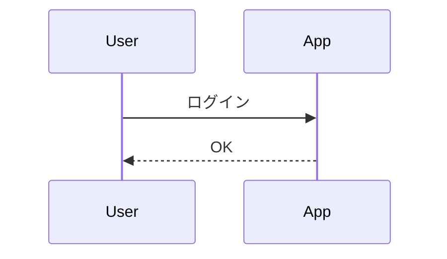

# mermaid4pptx

PowerPoint のスライドノートに書いた [Mermaid](https://mermaid.js.org/) 記法から図を生成し、スライドに挿入する PowerPoint アドイン（Office.js）。
元の Mermaid ソースは図形のタグと代替テキストに保存され、pptx 1ファイルの中で図とソースがそろいます。

> 設計: <https://claude.ai/artifact/54ygZBBySnzzAn4znTyyox>

## 対象環境

- 必須: PowerPoint for Windows（Microsoft 365）。検証基準は Version 2610 (Build 20527.20088)
- Mac・Web 版は後回し

## ノートの書き方

````text
発表者メモは自由に書けます。


````

- 1つのノートに複数のブロックを書けます。`id=` は任意（省略時は出現順に 1, 2, ...）。並べ替える可能性があるなら id を付けてください
- 全角の ｀｀｀ やスマートクォート（“ ”）も自動で直します
- 図ごとにテーマを変えたいときは、ブロックの先頭に `%%{init: {"theme": "forest"}}%%` と書きます（パネルのテーマ設定より優先）

## 使い方

ホームタブの「Mermaid」グループにある3つのボタンから使います（どれもワンクリックで実行）。

- **図を生成**: 表示中のスライドの図を生成・更新します。エラーがあるとパネルが開きます
- **全スライドを更新**: すべてのスライドで同じことをします
- **パネルを表示**: テーマの選択、「変更が無い図も作り直す」、結果の確認、サンプル

書き方に迷ったら、パネルの「サンプル」を開いてください。シーケンス図・フローチャート・状態遷移図・クラス図・ER図・ガントチャート・円グラフ・マインドマップの最小構成があり、「コピー」でノートに貼れる形（```mermaid の囲み付き）でコピーできます。

更新のルール:

- ノートが正本です。ノートを書き換えて押すと、同じ id の図を**位置と横幅を保ったまま**置き換えます
- 変更が無い図はそのまま（「変更が無い図も作り直す」に☑すると作り直します）
- 構文エラーのブロックは図に触らず、ノートの何行目かを表示します。ほかのブロックは処理します
- 図をコピーして同じスライドに貼った場合、同じ id の図はすべて更新します（それぞれの位置と横幅は保ちます）
- ノートから消したブロックの図は削除せず、「対応なし」と表示します（不要なら手で消してください）
- テーマは「テンプレートの色」「モダン（青）」（既定）「モノトーン」「ネイビー」「カスタム（色を選ぶ）」と mermaid 標準の default / neutral / dark / forest から選べます。プレゼンごとにファイル内に保存され、変えたら「全スライドを更新」で既存の図にも反映されます
- 「テンプレートの色」は、プレゼンのテーマの配色（デザイン → バリエーション → 配色）に合わせます。図形の塗りと枠はアクセント1、円グラフはアクセント1〜6を使います。配色を変えたら「全スライドを更新」で作り直されます。マスターが複数あるときは最初のマスターの配色を使います
- 「カスタム（色を選ぶ）」は、パネルでメイン色・サブ色・文字と線の色の3色を選んで使います。選んだ色はファイルの中に保存されます。初めて選んだときは、すでにある図の色合い（図が無ければテンプレートの色）から始まります。「テンプレートの色から始める」で、テーマの配色を初期値にできます。色を変えたら「全スライドを更新」で作り直されます
- 図ごとに色を変えたいときは、ブロックの先頭に `%%{init: {"theme": "base", "themeVariables": {"primaryColor": "#FDE2E2"}}}%%` のように書きます（`"theme": "base"` が必要）。書かなかった色はパネルのテーマのままです
- テーマを一度も選んでいないプレゼンは「モダン（青）」になります。以前の版で作った図は、次に更新したときにモダンで作り直されます

## 制限事項

- **アニメーションは再生されません。** エッジのアニメーション（`e1@{ animate: true }` や `animation: fast` など）を書いてもエラーにはなりませんが、図は静止画として挿入されるため動きません（線は破線になる見込み）。GIF や動画には変換しません。動かしたいときは、PowerPoint のアニメーションを図全体に手動で付けてください
- 図は画像（SVG）として入ります。PowerPoint の図形には分解しないので、文字や色はノートを書き換えて直してください
- 図の余白（何も描かれていない部分）をクリックしても図を選択・移動できません。線や枠の上をクリックしてください
- ノートはアドインから書き換えません（ノートを書き込む API がないため）
- Mac・Web 版の PowerPoint では動作を確認していません

## Windows で試す

前提: Windows 版の [Node.js](https://nodejs.org/) 22 以降、Git、PowerPoint for Windows。

> **WSL（Ubuntu など）の中では実行しないでください。** `npm start` は Windows のレジストリへのアドイン登録と、
> Windows の証明書ストアへの開発用証明書の登録を行うため、Windows の PowerShell から実行する必要があります。
> Node.js が無ければ `winget install OpenJS.NodeJS.LTS` で入れられます。
>
> `npm install` が `ECONNRESET` などの通信エラーで止まった場合は、もう一度実行してください。

```powershell
git clone https://github.com/yoohey/mermaid4pptx.git
cd mermaid4pptx
npm install
npm start
```

`npm start` は次を自動で行います。

1. 開発用の HTTPS 証明書を作成（初回のみ。証明書を信頼するか聞かれるので「はい」）
2. `https://localhost:3000` で開発サーバーを起動
3. アドインを登録（サイドロード）して PowerPoint を起動

PowerPoint の「ホーム」タブ右端に **図を生成**・**全スライドを更新**・**パネルを表示** のボタンが出ます。終了するときは `npm stop`。

> 開発用に読み込んだアドインは、`npm start` を実行している間だけ使えます。
> 止めた状態でファイルを開くと「アドイン エラー」と出ますが、もう一度 `npm start` すれば戻ります。
>
> リボンのボタンが古いまま変わらないときは、PowerPoint を閉じて `npm stop` の後、
> Office のアドインキャッシュ（`%LOCALAPPDATA%\Microsoft\Office\16.0\Wef\` の中身）を消してから `npm start` してください。

## 開発

```sh
npm test          # 単体テスト（vitest）
npm run typecheck # 型チェック
npm run build     # dist/ に本番ビルド（THIRD-PARTY-NOTICES.txt も生成）
npm run validate  # マニフェスト検証（Microsoft のサービスに接続）
```

テスト用 pptx は `python3 test/fixtures/make_fixture.py`（python-pptx が必要）で再生成できます。

## 配布版の公開

開発は非公開の開発用リポジトリで行い、リリースのたびにソースを公開用リポジトリ（`PUBLIC_REPO`）へ送って、その GitHub Pages から配信します。
配信元は `https://<owner>.github.io/<公開用リポジトリ名>/` です。

```sh
npm run build:release    # dist/ に本番ビルドと配布用 manifest.xml を作る
npm run validate:release # 配布用マニフェストの検証
```

- 配布用マニフェストは `manifest.xml` から `scripts/build-manifest.js` が作ります。URL を `https://localhost:3000` から配信元に置き換え、開発版と別の Id にして、表示名の「(dev)」を外します。配信元は環境変数 `ADDIN_BASE_URL` で変えられます
- リリースの手順: `manifest.xml` の `<Version>` と `package.json` の `version` を上げ、`CHANGELOG.md` を書いて main にマージ → `v1.2.3` のようなタグを push
- タグを push すると `.github/workflows/release.yml` が次を行います
  1. 開発用リポジトリ: その時点のファイルを1コミットにまとめ、公開用リポジトリへタグごと送る。開発の履歴やコミットの作者情報は送りません（作者は github-actions[bot]）
  2. 公開用リポジトリ: テスト・ビルドの後に GitHub Pages へ公開し、GitHub Releases に `manifest.xml` を添付する（タグと `<Version>` が合わないと止まります）
- 配布版の Id は一度配ったら変えないでください（変えると別のアドイン扱いになり、利用者が入れ直すことになります）

初回だけの準備:

1. 公開用リポジトリを Public で作る。「Add a README file」に☑して、空ではない状態にする
2. 公開用リポジトリの Settings → Pages → Source を「GitHub Actions」にする
3. 公開用リポジトリだけに書き込める fine-grained personal access token を作る（Repository access: 公開用リポジトリのみ、Permissions: Contents = Read and write、Workflows = Read and write）
4. 開発用リポジトリの Settings → Secrets and variables → Actions に、シークレット `PUBLIC_REPO_TOKEN`（3 のトークン）と、変数 `PUBLIC_REPO`（例: `yoohey/mermaidOnPptx`）を登録する

## ライセンス

[MIT](LICENSE)。同梱する第三者ライブラリのライセンスはビルド時に `dist/THIRD-PARTY-NOTICES.txt` に出力されます。

このアドインは非公式のもので、Mermaid プロジェクトおよび Mermaid Chart 社とは関係ありません。
