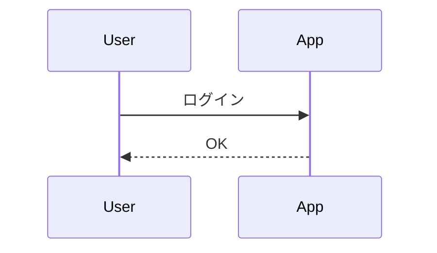

# Mermaid on PowerPoint

PowerPoint のスライドノートに書いた [Mermaid](https://mermaid.js.org/) 記法から図を生成し、スライドに挿入する PowerPoint アドイン（Office.js）。
元の Mermaid ソースは図形のタグと代替テキストに保存され、pptx 1ファイルの中で図とソースがそろいます。

利用ガイド（どんなアドインか・入れ方・使い方）: [site/guide.pptx](site/guide.pptx)（配布サイトからもダウンロードできます）

> **注意**: 現在は作者が自分で使いながら試している段階（ドッグフーディング中）です。予告なく仕様の変更や配信の停止をすることがあります。MIT ライセンスのとおり無保証で、利用によって生じた問題には責任を負えません。大切な資料はバックアップを取ってからお使いください。

## 対象環境

- 必須: PowerPoint for Windows（Microsoft 365）。検証基準は Version 2610 (Build 20527.20088)
- Mac・Web 版は後回し

## ノートの書き方

````text
発表者メモは自由に書けます。


````

- 1つのノートに複数のブロックを書けます。`id=` は任意（省略時は出現順に 1, 2, ...）。並べ替える可能性があるなら id を付けてください
- 全角の ｀｀｀ やスマートクォート（“ ”）も自動で直します
- 図ごとにテーマを変えたいときは、ブロックの先頭に `%%{init: {"theme": "forest"}}%%` と書きます（パネルのテーマ設定より優先）

## 使い方

ホームタブの「Mermaid」グループにある3つのボタンから使います（どれもワンクリックで実行）。

- **図を生成**: 表示中のスライドの図を生成・更新します。エラーがあるとパネルが開きます
- **全スライドを更新**: すべてのスライドで同じことをします
- **パネルを表示**: テーマの選択、「変更が無い図も作り直す」、結果の確認、サンプル

書き方に迷ったら、パネルの「サンプル」を開いてください。シーケンス図・フローチャート・状態遷移図・クラス図・ER図・ガントチャート・円グラフ・マインドマップの最小構成があり、「コピー」でノートに貼れる形（```mermaid の囲み付き）でコピーできます。

更新のルール:

- ノートが正本です。ノートを書き換えて押すと、同じ id の図を**位置と横幅を保ったまま**置き換えます
- 変更が無い図はそのまま（「変更が無い図も作り直す」に☑すると作り直します）
- 構文エラーのブロックは図に触らず、ノートの何行目かを表示します。ほかのブロックは処理します
- 図をコピーして同じスライドに貼った場合、同じ id の図はすべて更新します（それぞれの位置と横幅は保ちます）
- ノートから消したブロックの図は削除せず、「対応なし」と表示します（不要なら手で消してください）
- テーマは「テンプレートの色」「モダン（青）」（既定）「モノトーン」「ネイビー」「カスタム（色を選ぶ）」と mermaid 標準の default / neutral / dark / forest から選べます。プレゼンごとにファイル内に保存され、変えたら「全スライドを更新」で既存の図にも反映されます
- 「テンプレートの色」は、プレゼンのテーマの配色（デザイン → バリエーション → 配色）に合わせます。図形の塗りと枠はアクセント1、円グラフはアクセント1〜6を使います。配色を変えたら「全スライドを更新」で作り直されます。マスターが複数あるときは最初のマスターの配色を使います
- 「カスタム（色を選ぶ）」は、パネルでメイン色・サブ色・文字と線の色の3色を選んで使います。選んだ色はファイルの中に保存されます。初めて選んだときは、すでにある図の色合い（図が無ければテンプレートの色）から始まります。「テンプレートの色から始める」で、テーマの配色を初期値にできます。色を変えたら「全スライドを更新」で作り直されます
- 図ごとに色を変えたいときは、ブロックの先頭に `%%{init: {"theme": "base", "themeVariables": {"primaryColor": "#FDE2E2"}}}%%` のように書きます（`"theme": "base"` が必要）。書かなかった色はパネルのテーマのままです
- テーマを一度も選んでいないプレゼンは「モダン（青）」になります。以前の版で作った図は、次に更新したときにモダンで作り直されます

## 制限事項

- **アニメーションは再生されません。** エッジのアニメーション（`e1@{ animate: true }` や `animation: fast` など）を書いてもエラーにはなりませんが、図は静止画として挿入されるため動きません（線は破線になる見込み）。GIF や動画には変換しません。動かしたいときは、PowerPoint のアニメーションを図全体に手動で付けてください
- 図は画像（SVG）として入ります。PowerPoint の図形には分解しないので、文字や色はノートを書き換えて直してください
- 図の余白（何も描かれていない部分）をクリックしても図を選択・移動できません。線や枠の上をクリックしてください
- ノートはアドインから書き換えません（ノートを書き込む API がないため）
- Mac・Web 版の PowerPoint では動作を確認していません

## 導入

導入の手順は <https://yoohey.github.io/mermaidOnPptx/> をご覧ください。

## ライセンス

[MIT](LICENSE)。同梱する第三者ライブラリのライセンスはビルド時に `dist/THIRD-PARTY-NOTICES.txt` に出力されます。

このアドインは非公式のもので、Mermaid プロジェクトおよび Mermaid Chart 社とは関係ありません。
